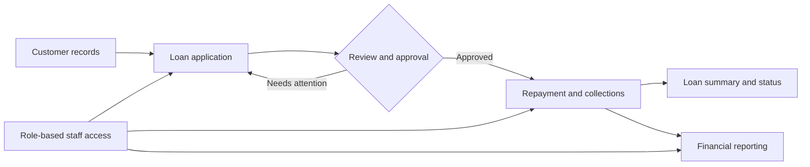

<div align="center">
  

  # Lanka Capital ERP

  **A lending operations and financial management platform for NKRS Lanka Capital Pvt. Ltd.**

  Manage customers, loans, collections, staff, and financial reporting through one role-aware web application.

  <p>
    
    
    
    
    
  </p>
</div>

---

## At a glance

Lanka Capital ERP brings day-to-day lending workflows into a single system. Staff can register customers, process loan applications, record repayments, and review operational activity, while administrators manage users and access financial information.

| Area | What it helps with |
| --- | --- |
| **Customers & loans** | Customer records, loan applications, approvals, loan status, and summaries |
| **Collections** | Daily collection entry, installment history, due tracking, and officer collection views |
| **People & operations** | Role-aware screens, employee management, salaries, and administrative expenses |
| **Financials** | Financial dashboards, reports, and supporting worksheets |

## Explore the workflows



### By role

- **Administrators** — oversee loan and customer activity, manage employees and menu access, review collections, and access reports.
- **Receptionists** — work with customer and loan records, view loan information, and submit or track administrative expenses.
- **Field officers** — access field workflows and collection information relevant to their role.

## Feature tour

<details>
  <summary><strong>Customer and loan operations</strong></summary>

- Register and search customer records.
- Submit and review loan applications.
- Track loan status, installment amounts, payments, and outstanding due.
- Review loan summaries and payment history.
</details>

<details>
  <summary><strong>Collections</strong></summary>

- Record daily repayments and partial payments.
- Review collection history and due amounts.
- View collection performance by field officer and today's collection totals.
</details>

<details>
  <summary><strong>Administration and financials</strong></summary>

- Manage employees, roles, and administrator menu permissions.
- Review salary and administrative expense records.
- Access financial dashboards, reports, and supporting financial worksheets.
</details>

## Built with

| Layer | Technologies |
| --- | --- |
| **Web client** | React 19, Vite, JavaScript, Tailwind CSS, React Router |
| **API** | Java 21, Spring Boot, Spring Web, Spring Data JPA, Spring Security |
| **Persistence** | MySQL |
| **Authentication** | JWT-based authentication and role-aware access |
| **Build tools** | npm, Maven Wrapper |

## How the project fits together

```text
LankaCapital_ERP_Web/
├── client/                         # React/Vite application
│   └── src/
│       ├── api/                    # API client
│       ├── component/              # Shared layouts and UI
│       └── pages/                  # Admin, receptionist, field, and public screens
└── server/                         # Spring Boot API
    └── src/main/java/com/lankacapital/server/
        ├── config/                 # Security, CORS, and application configuration
        ├── controllers/            # REST endpoints
        ├── dtos/                   # Request and response models
        ├── entities/               # JPA persistence models
        ├── mappers/                # Entity/DTO mapping
        ├── repositories/           # Database access
        └── services/               # Application and business logic
```

## Run locally

### Prerequisites

- Java 21
- Node.js and npm
- MySQL

### 1. Get the code and prepare the database

```bash
git clone https://github.com/chira0001/LankaCapital_ERP_Web.git
cd LankaCapital_ERP_Web
```

Create a MySQL database for the application, then create `server/.env` with values for your local environment:

```dotenv
DB_URL=jdbc:mysql://localhost:3306/lankacapital_erp
DB_USERNAME=your_mysql_username
DB_PASSWORD=your_mysql_password
DB_DRIVER=com.mysql.cj.jdbc.Driver
SECRET_STRING=replace_with_a_long_random_secret
FRONTEND_URL=http://localhost:5173
```

Keep `.env` local—never commit database passwords or signing secrets.

> **Existing database?** If it still has the previous expense table names, run [`administrative-expense-migration.sql`](server/src/main/resources/templates/administrative-expense-migration.sql) once before starting the updated backend. The migration renames the tables and preserves their records.

### 2. Start the API

```bash
cd server
./mvnw spring-boot:run
```

On Windows PowerShell, use:

```powershell
.\mvnw.cmd spring-boot:run
```

The API starts on `http://localhost:8080`; API routes are under `/api/v1`.

### 3. Start the web client

In another terminal:

```bash
cd client
npm install
npm run dev
```

Open `http://localhost:5173`. Vite proxies `/api` requests to the local API. To use a different backend URL, set `VITE_BACKEND_URL` in the client environment (the default is `http://localhost:8080/api/v1`).

## Useful commands

| From | Command | Purpose |
| --- | --- | --- |
| `client/` | `npm run dev` | Start the development server |
| `client/` | `npm run build` | Create the production client build |
| `client/` | `npm run lint` | Run ESLint |
| `server/` | `./mvnw spring-boot:run` | Start the Spring Boot API |
| `server/` | `./mvnw test` | Run backend tests |

## API areas

| Prefix | Purpose |
| --- | --- |
| `/api/v1/auth` | Authentication |
| `/api/v1/admin` | Administration and reporting |
| `/api/v1/recep` | Receptionist workflows |
| `/api/v1/field` | Field officer workflows |

## Project team

- **Chirath Wijesinghe**
- **Shanuka Gamlath**
- **Vihaga Yasitha**

## License and use

Copyright © 2026.

This repository is published for portfolio and demonstration purposes. The deployed software and business implementation belong to the client under the signed Software Handover Agreement. Do not copy, redistribute, or commercially reuse this work without written permission.

<div align="center">
  <sub>Built to make lending operations clearer, more connected, and easier to manage.</sub>
</div>
